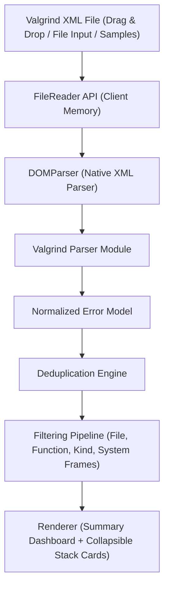

# Technical Specification: Valgrind XML Web Viewer (`valgrind-webui`)

## 1. Overview & Purpose
A lightweight, zero-backend, client-side web application designed to visualize, filter, and inspect Valgrind XML reports. Hosted entirely on GitHub Pages, it allows C++ developers to drag and drop or open Valgrind XML files (`--xml=yes`) and immediately analyze memory leaks, invalid memory access, uninitialized variables, and thread concurrency defects.

---

## 2. Key Constraints & Guarantees
1. **100% Client-Side:** No server required. Runs in the browser via standard Web APIs (`FileReader`, `DOMParser`).
2. **Zero External Dependencies / Vendored Only:** No CDN links (`cdnjs`, `unpkg`, etc.) that can break offline or over time. Pure native ES6+ JavaScript and modern CSS.
3. **Multi-Tool Compatibility:** Supports reports generated by:
   - `memcheck` (InvalidRead, InvalidWrite, Leak_DefinitelyLost, Leak_IndirectlyLost, Leak_StillReachable, UninitCondition, etc.)
   - `helgrind` & `drd` (LockOrder, Race, PossibleDataRace, Misc)
   - Generic/custom Valgrind tools outputting standard Valgrind XML protocol (v4/v5).
4. **Minimalist & Developer-Centric UI:** High-density, high-contrast, clean typography, monospace stack traces, dark/light mode toggle.

---

## 3. Architecture & Data Flow



### 3.1 Normalized Data Model
Each error element `<error>` in the XML is parsed into a uniform JavaScript object:
```typescript
interface StackFrame {
  ip: string;          // Instruction pointer (e.g. 0x4005B6)
  obj: string;         // Object/binary name (e.g. /usr/bin/myprog)
  fn: string;          // Function signature (e.g. main or std::vector<...>)
  dir: string;         // Directory path
  file: string;        // Source file name (e.g. main.cpp)
  line: number | null; // Line number
  isSystem: boolean;   // True if frame belongs to libc, ld-linux, etc.
}

interface StackTrace {
  frames: StackFrame[];
}

interface ValgrindError {
  id: string;          // Unique ID or generated sequence
  unique: string;      // Valgrind <unique> identifier
  tid: number;         // Thread ID (<tid>)
  kind: string;        // E.g., 'InvalidRead', 'Leak_DefinitelyLost', 'Race'
  category: string;    // 'memory_corruption' | 'leak' | 'uninitialized' | 'concurrency' | 'other'
  what: string;        // Primary message from <what> or <xwhat><text>
  leakedBytes?: number;
  leakedBlocks?: number;
  primaryStack: StackTrace;
  auxiliary: Array<{
    info: string;      // from <auxwhat> or <annwhat>
    stack?: StackTrace;
  }>;
  suppression?: string; // Valgrind suppression block if present
}
```

---

## 4. Feature Specifications

### 4.1 Deduplication Filter
- **Problem:** Loops, repetitive function calls, or multiple threads produce dozens or hundreds of identical errors differing only by thread ID or timestamp.
- **Deduplication Strategies:**
  1. **Top User Frame + Kind (Default):** Groups errors having the same `kind` and the first non-system source frame (`file:line:fn`).
  2. **Exact Stack Hash:** Groups errors having the exact same function call sequence.
  3. **Disabled (Raw):** Preserves individual occurrences sequentially.
- **UI Representation:**
  - Displays a count badge (e.g. `× 3`).
  - Expanding reveals the common stack trace, list of distinct thread IDs, and instances.

### 4.2 Filtering Capabilities
- **Separate Filter Inputs:**
  - `Filename Filter`: Substring/case-insensitive match against `frame.file` or `frame.dir`.
  - `Function Filter`: Substring/case-insensitive match against `frame.fn`.
- **Kind Filter:** Filter by error categories:
  - *All*
  - *Memory Errors* (`InvalidRead`, `InvalidWrite`, `InvalidFree`, `Overlap`)
  - *Leaks* (`Leak_DefinitelyLost`, `Leak_IndirectlyLost`, `Leak_PossiblyLost`, `Leak_StillReachable`)
  - *Uninitialized* (`UninitCondition`, `UninitValue`)
  - *Concurrency* (`Race`, `LockOrder`, `PossibleDataRace`)
- **System Frame Filtering ("User Code Only"):**
  - Ability to collapse or dim library frames (`/usr/lib/*`, `libc.so*`, `libstdc++*`, `ld-linux*`) so developers immediately see their own code.

### 4.3 Report Preamble & Summary Bar
- Displays tool used (`memcheck`, `helgrind`, etc.), execution command line (`<argv>`), PID, and execution date/time.
- Summary metrics:
  - Total Errors count (raw vs deduplicated).
  - Total Definite / Indirect / Reachable bytes leaked (for Memcheck).
  - Distinct source files affected.

### 4.4 Stack Trace Inspection & Developer Utilities
- Clean monospace rendering formatted as `fn() at file.cpp:line`.
- Clickable file:line link format (prepared for copy).
- **Copy Suppression Rule:** 1-click button to copy Valgrind suppression block formatted for `.supp` files.
- **Copy Stack:** 1-click button to copy markdown-formatted stack trace for issue trackers (Jira/GitHub).

---

## 5. File Structure
```text
valgrind_webui/
├── index.html            # Main HTML structure, layout, and control bar
├── css/
│   └── styles.css        # Minimalist, high-contrast, theme-ready CSS
├── js/
│   ├── app.js            # Main controller & state management
│   ├── parser.js         # Valgrind XML parser (DOMParser-based)
│   ├── dedup.js          # Grouping & deduplication algorithms
│   ├── filter.js         # Search & filtering pipeline
│   ├── ui.js             # View rendering & interactive components
│   └── samples.js        # Embedded sample reports
├── samples/
│   ├── memcheck_sample.xml  # Sample Memcheck report with leaks & invalid reads
│   └── helgrind_sample.xml  # Sample Helgrind report with threading race
├── README.md             # Documentation & GitHub Pages setup guide
└── SPEC.md               # Technical specification
```
